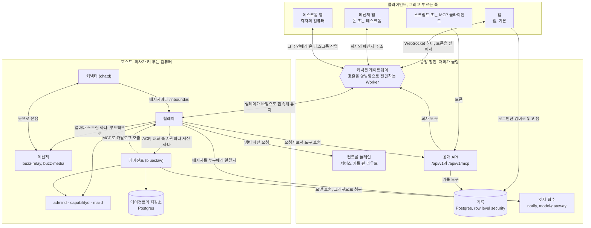
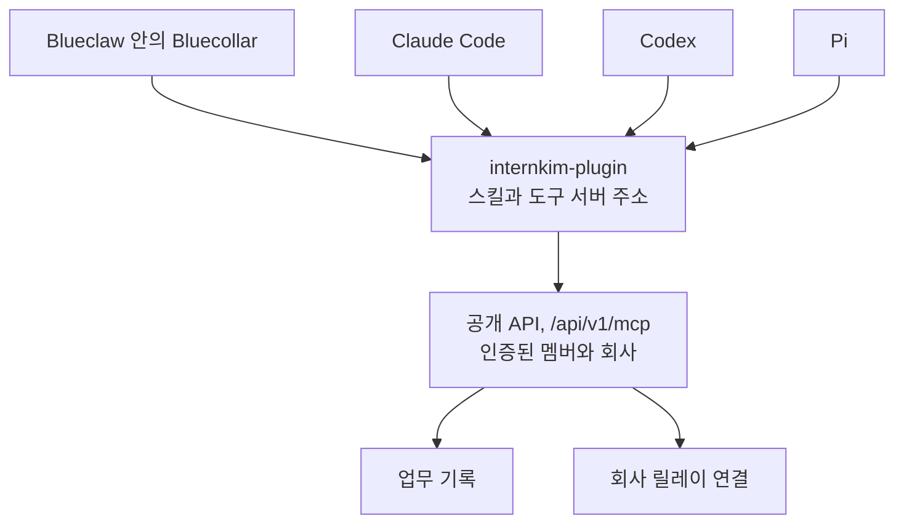

기계 두 대입니다. 한 대는 어떤 컴퓨터가 사라져도 살아남아야 하는 것을 담고,
다른 한 대는 에이전트를 돌리며 그 기계 위에서만 의미가 있는 것을 담습니다.



호스트를 떠나는 화살표는 전부 바깥을 향합니다. 안으로 향하는 것은 없습니다.

## 앱이 읽는 방식 [#how-the-app-reads]

웹 앱과 네이티브 앱이 함께 쓰는 웹 화면은 같은 방식으로 읽습니다. 라우트는
세션과 회사 소속을 확인한 뒤에야 계정별 데이터를 받아들입니다. 화면은 그
계정으로 마지막에 읽은 스냅샷으로 먼저 열리고 뒤에서 다시 읽습니다. 쓰기,
로그아웃, 거절된 읽기는 스냅샷을 버리고, 기록을 편집하려면 새로 읽은 데이터가
있어야 합니다. 업무 보드는 화면에 보이는 범위만 읽고, 전체 이력이 필요한
화면은 그때 요청합니다. 근태 화면은 본인 상태를 `attendance_current_get`으로,
동료는 `attendance_team_page_get`으로 한 페이지씩 읽습니다. 서비스 워커는
배포된 정적 파일을 캐시하고, 인증된 페이지나 API 응답은 캐시하지 않습니다. 이
읽기의 시간을 재는 방법은 [테스트](/ko/testing#measuring-speed)에 있습니다.

## 여러 하네스가 쓰는 하나의 플러그인 [#one-plugin-across-harnesses]

blueclaw는 메타 하네스입니다. 회사의 모든 사람을 위해 에이전트 하네스를 돌리고,
하네스가 혼자서는 가질 수 없는 것을 채워 줍니다. 메시지마다 그 뒤에 있는 사람과
그 사람의 POSIX 사용자, 그 사람의 스레드에서 받는 승인, 태스크 원장과 스케줄이
그것입니다. 회사 호스트는 기본 하네스인 bluecollar를 돌립니다. blueclaw는 그
자리에 Claude Code, Codex, Antigravity나 어떤 ACP 에이전트든 돌릴 수 있고, 어느
하네스든 같은 사실을 전달받고, 같은 방식으로 승인을 묻고, 요청자로서 실행되며,
승인이나 재시작 뒤에 자기 세션을 이어 갑니다.

`internkim-plugin`은 공통 클라이언트 패키지입니다. 에이전트가 여기서 스킬을 불러오고,
Claude Code, Codex, Pi도 같은 패키지를 설치해 각자의 루프에서 회사의 도구를 쓸 수 있습니다.



플러그인은 평범한 Agent Plugins 체크아웃입니다. `plugin.json`, `https://api.intern.kim/v1/mcp`를
가리키는 `mcp.json`, `skills/`로 이루어지고, 하네스 어댑터는 없습니다. 각 클라이언트가 이 구조를
자기 방식으로 불러오며, 방법은 플러그인의 README에 있습니다.

서비스는 도구 계약을 한 번만 작성하고, 호출자의 인증에서 행위자를 정하며 현재 회사 멤버십을
확인합니다. 그래서 모델이 넘긴 인자로 더 높은 권한의 신원을 고를 수 없습니다. MCP는 도구 호출을
나르고, ACP는 릴레이가 메신저 대화를 에이전트에게 넘기는 별도의 경계입니다. 플러그인만 쓸 때는
ACP 세션이 필요 없습니다. 플러그인을 설치해도 외부 에이전트에게 blueclaw의 워크스페이스나
터미널이 열리지는 않습니다.

bluecollar에서 모델의 커널은 `read`, `write`, `edit`, `bash`, `plan`, `equip`이고,
그 곁에 blueclaw [레퍼런스](https://blueclaw.intern.kim)가 나열하는 파일·스킬·질문·기억 도구가 있습니다.
`plan`은 목표와 단계, 실행 규모를 정하는 수준을 기록합니다. `equip`은 필요를 설명한 문장을 받아
그에 맞는 도구를 돌려주고, 나머지 회사 카탈로그는 계획 단계마다 한 번 정해지는 후보 목록으로
모델에 전달됩니다. 모델은 말과 파일을 담은 하나의 `reply`로 말하며, 이 `reply`는 누군가 답할
때까지 실행을 멈추게 하거나 선택지를 버튼으로 제시할 수 있습니다.

## 중앙 쪽 [#the-central-side]

우리가 배포하는 다섯 가지입니다.

| | 무엇인지 | 어디 사는지 |
|---|---|---|
| 기록 | row level security 뒤의 Postgres | `supabase/migrations` |
| 컨트롤 플레인 | 서비스 키를 쥔 서버 라우트 | `web/src/routes/api/agent/` |
| 앱 | Cloudflare Pages 위의 SvelteKit 빌드. 사람이 로그인하는 화면을 서빙 | `web/` |
| 공개 API | 같은 빌드 안의 서버 라우트. 토큰과 MCP 클라이언트에 답함 | `web/src/routes/api/v1/` |
| 커넥션 게이트웨이 | 회사마다 Durable Object 하나를 두는 Worker. 브라우저 호출, API 호출, 네이티브 메신저 앱, 회사의 작업 큐, 각자의 컴퓨터로 가는 데스크톱 작업을 함께 나름 | `workers/connection-gateway/` |

기록은 모든 읽기와 쓰기에 어떤 멤버로서 답하고, 관리자로서 답하는 일은
없습니다. 세션이 어떤 행을 보는지는 데이터베이스 자신이 정합니다. 테이블
목록은 [무엇이 어디 사는지](/ko/what-lives-where)에 있습니다.

컨트롤 플레인은 멤버 혼자서는 할 수 없는 일을 위해 존재합니다. 호출자는
회사의 에이전트 키로 인증하고, 돌아오는 것은 세션입니다.
`POST /api/agent/session`은 회사가 아는 신원을 멤버 세션으로 바꾸고,
`POST /api/agent/host-session`은 회사 컴퓨터를 그 자신으로 로그인시킵니다.
같은 디렉토리의 이웃 라우트들은, 그렇게 로그인한 호스트가 호출마다 필요한
자격증명을 읽게 (`/api/agent/messenger-credential`,
`/api/agent/mail-account`) 해 줍니다. 서비스 키는 이 라우트들을 떠나지
않습니다. 알림은 프로젝트 자신의 엣지 함수(`supabase/functions/`)가 보내므로,
모든 멤버의 기기를 읽는 키는 그 회사의 Supabase 안에 머뭅니다. 그 곁의
`model-gateway` 함수는 회사의 크레딧으로 모델 호출을 팝니다.
[크레딧](/ko/record/schema#credits)에 설명이 있습니다.

앱이 어느 Supabase 프로젝트에 말을 거는지는 런타임에 정해집니다.
`hooks.server.ts`가 값을 `#central-plane` 엘리먼트에 주입하므로, 하나의 빌드가
모든 회사를 서빙합니다. 화면은 비밀을 쥐지 않습니다. `/api/` 아래 라우트는 쥐고,
그래서 서버에서 돕니다. 모두가 하나의 주소에서 로그인하고, 존의 다른 모든
호스트네임은 그리로 `308`을 답합니다. 예외는 `/api/`와 `/v1/` 아래 경로로, 교차
출처 리다이렉트가 호출자의 베어러 토큰을 떨어뜨리기 때문에 도착한 곳에서 그대로
답합니다. `api.<zone>/v1`이 `<zone>/api/v1`과 같은 API로 답하는 것은 이 예외
덕분입니다.

공개 API에 도구 카탈로그가 삽니다. 모든 도구는
`web/src/lib/server/public-api/catalog/`에서 한 번만 정의되고, 정의마다 누가
답하는지를 밝힙니다.

| `answeredBy` | 누가 실행하는지 | 예 |
|---|---|---|
| `record` | 앱이 직접, 부른 멤버로서 기록에 대고 | 업무, 캘린더, 사람, 연차, 근태, CRM |
| `company` | 게이트웨이로 닿는 회사의 컴퓨터 | 메시지, 메일, 웹 검색, 문서 읽기 |
| `local` | 에이전트 곁에서만. API는 거절함 | 브라우저, 요청자 자신의 컴퓨터 |

`/api/v1/mcp`는 같은 카탈로그를 어떤 MCP 클라이언트에게든 서빙하고, 아래
절들이 보여 주듯 에이전트 자신이 도구에 닿는 길도 이것입니다. 전체 도구는
[카탈로그](/ko/tools/catalog)에 있습니다.

커넥션 게이트웨이는 서로 접속을 받지 않는 브라우저와 호스트가 닿는
방법입니다. 브라우저는 Supabase 세션 토큰을 실어 `/company/<id>/client`로
WebSocket을 열고, Worker는 그 토큰을 프로젝트의 JWKS로 검증해 어느 멤버가
부르는지 해석한 뒤, 소켓을 그 회사의 Durable Object
(`CompanyConnectionObject`)에 넘깁니다. 호스트의 릴레이는 자기 쪽에서
`/company/<id>/server`로 접속해 머무르며, Durable Object가 보관하는 서버 키로
인증합니다. 오브젝트는 호출을 한쪽으로, 응답을 반대쪽으로 전달하고, 릴레이가
새 메시지를 알리면 열린 채팅 화면에 `message.arrived`를 밀어 주고, 회사
컴퓨터가 지금 연결되어 있는지 자체를 브라우저에 알려 줍니다.

같은 오브젝트가 회사의 작업 큐도 맡습니다. 박스마다 `/company/<id>/worker`로
접속해 여유가 얼마나 있는지 알립니다. 서비스 박스는 브라우저가 하나라도 비어
있으면 브라우저 호출을 직접 처리하고, 아니면 `/company/<id>/work`에 올려 여유가
있는 박스 아무나 가져가게 합니다([박스를 여러 대 두기](/ko/kim-mini#more-than-one-box)).

internkim 데스크톱 앱은 그 사람이 이 컴퓨터를 쓰도록 허용하면 로그인한
멤버의 세션 토큰을 실어 `/company/<id>/desktop`으로 접속합니다. Worker는
`/client`와 같은 방법으로 멤버를 해석하고 그 사람의 이메일 주소로 소켓을
구분합니다. 어떤 사람의 데스크톱에 보낼 작업은 릴레이를 거쳐 호스트를
떠납니다. capabilityd가 릴레이의 `/desktop-work`에 올리면, 릴레이가 회사를 맡은
호스트로 서명해 `/company/<id>/desktop-work`로 넘깁니다. 작업은 그 주소를
적고, Durable Object는 그 사람의 소켓에만 작업을 건네며 열린 소켓이 없으면
`503`으로 답합니다. 다른 사람의 데스크톱이나 박스로는 가지 않고, 회사 작업이
데스크톱으로 가는 일도 없습니다. 게이트웨이는 데스크톱 작업을 120초 동안 붙잡고,
두 데스크톱 도구도 그 한도를 밝힙니다. 데스크톱 도구가 그곳에서 하는 일은
[내 컴퓨터](/ko/tools#desktop)에 있습니다.

폰이나 데스크톱의 네이티브 메신저 앱은 회사의 메신저 주소 `<slug>.<zone>`으로
접속합니다. 이 주소는 Pages 호스트네임이 아니라 같은 Worker의 라우트입니다.
Worker는 첫 레이블로 회사를 찾고, 호스트가 유지하는 연결 위에 스트림을 엽니다.
`stream.open` 다음에 `stream.frame`과 `stream.close`가 오고, 모두 스트림 ID를
답니다. 릴레이는 스트림마다 회사의 Buzz 릴레이에 루프백으로 접속하면서 앱이
접속한 주소를 그대로 내밀기 때문에, 앱의 NIP-42 로그인은 그것을 검사하는
릴레이에 그대로 닿고 게이트웨이는 프레임을 읽지 않습니다. Buzz 릴레이 자신의
한도인 512 KiB를 넘는 프레임은 스트림에 들어가기 전에 거절됩니다. 호스트의
연결이 끊기면 모든 스트림이 `1012`로 닫히고 앱은 다시 접속합니다. 릴레이는
스트림을 번갈아 한 프레임씩 내보내므로, 바쁜 구독 하나가 연결을 붙잡을 수
없습니다.

앱이 보내는 나머지는 HTTP입니다. NIP-98 조회, 초대, 릴레이 정보 문서는 같은
연결 위의 호출로 오갑니다.

블롭을 누가 읽을 수 있는지는 릴레이가 정하고, 바이트는 버킷에 있는 회사의
사본에서 나옵니다. 게이트웨이는 먼저 앱이 보낸 헤더를 토큰과 범위까지 그대로
담아 `messenger.media.head`를 호출하고, 호스트는 꼭 그 헤더로 자기 릴레이에
HEAD를 묻습니다. 거절은 릴레이가 준 그대로, 본문 없이 앱에 돌아갑니다.
릴레이가 읽기를 허락하고 버킷에 `<company>/shared/transfer/<digest>` 사본이
있으면, 호스트는 1분 동안 유효하게 서명한 사본 주소로 답합니다. 게이트웨이는
앱의 범위로 사본을 읽어 릴레이의 헤더와 사본의 길이·범위로 답하므로, 바이트는
Durable Object도 호스트의 연결도 지나지 않습니다.

아직 사본이 없으면 게이트웨이가 `media.open`을 보내고, 호스트는 자기 릴레이의
답을 흘려보냅니다. 상태와 헤더, 512 KiB 이하 바이너리 프레임으로 나눈 본문,
`media.end` 순서입니다. 호스트는 게이트웨이가 허락한 바이트만 보내고,
게이트웨이는 앱이 읽는 만큼 허락하므로, Durable Object가 쥐는 양은 블롭 하나에
512 KiB, 동시에 블롭 32개까지입니다. 그동안 호스트는 앱이 몇이 묻든
다이제스트마다 한 번 사본을 채웁니다. 회사가 요청자를 위해 가진 키로, 요청자로서
커넥터를 거쳐 블롭 전체를 읽으며, 브라우저의 읽기도 이렇게 합니다. 채우기가
실패하면 다이제스트와 이유를 담은 로그가 한 줄 남습니다.

업로드는 버킷에 먼저 놓이고, 호스트가 거기서 꺼내 자기 릴레이에 넘깁니다.
릴레이가 받아들이며 밝힌 다이제스트가 놓인 바이트의 해시와 같으면, 놓인 객체는
그 다이제스트의 사본 자리로 옮겨집니다. 그래서 앱이 보낸 파일은 처음부터
사본에서 읽힙니다. 리다이렉트가 버킷에 놓는 것보다 간단하지만, 데스크톱 앱은
파일을 저장하거나 복사할 때 리다이렉트를 거절합니다.

호스트는 연결할 때 자기가 할 수 있는 일을 밝힙니다. `messenger.media.head`를
밝히지 않는 호스트에는 HEAD를 묻지 않고 모든 읽기를 흘려보내게 합니다.
`messenger.media.stream`도 밝히지 않는 호스트에는 가장 오래된 방식으로 묻고,
그 방식은 답하기 전에 블롭을 버킷에 복사합니다. `media.open`에 바이너리
프레임을 청하지 않는 게이트웨이에게 호스트는 본문을 JSON 속 base64로
보냅니다.

Durable Object는 모든 소켓을 WebSocket Hibernation API로 받습니다. 소켓마다의
역할은 그 소켓의 attachment에 있고, 호스트의 keep-alive ping에는 런타임이
오브젝트를 깨우지 않고 답하며, 아직 답을 기다리는 멤버의 호출은 오브젝트의
저장소에 남습니다. 그래서 오브젝트는 메시지 사이에 잠들어도 잃는 것이 없습니다.

## 호스트 위의 프로세스들 [#the-processes-on-the-host]

패키지가 이들을 각각 systemd나 launchd 서비스로 등록하고, 확인하는 방법은
[호스트 굴리기](/ko/running-the-host)가 설명합니다.

| 프로세스 | 응답 위치 | 하는 일 | 코드 |
|---|---|---|---|
| 릴레이 (`internkim-relay`) | 바깥으로만; 커넥터를 위해 `127.0.0.1:18091` | 앱의 호출에 답하고, 메시지를 에이전트의 턴으로 바꾸고, 에이전트에게 도구를 서빙 | `host/relay/` |
| 커넥터 (`chatd`) | `127.0.0.1:18090` | Buzz용 메신저 어댑터 | `.dependency/blueclaw/chatd/` |
| 에이전트 (`blueclaw`) | `/run/internkim/acp/blueclaw-acp.sock`; 관리 API는 `127.0.0.1:8080` | 메타 하네스와 그 ACP 에이전트: 실행, 승인, 태스크 원장, 기억 | `.dependency/blueclaw/` |
| `internkim-capabilityd` | `/run/internkim/capability.sock` | 에이전트의 도구 호출에 답하고 그 프로바이더 자격증명을 쥠: 메일·웹·브라우저·데스크톱 도구. 임베딩 요청은 임베딩 서버로 넘김 | `cmd/internkim-capabilityd/`, `internal/capabilityd/` |
| Moli (`moli serve`), 요청자마다 하나 | `127.0.0.1:9230`부터 | 공개 페이지의 단순한 텍스트를 탐색하는 디바이스 브라우저. capabilityd가 사람마다 처음 쓸 때 그 사람의 프로필로 띄우고, 쓰지 않으면 내립니다 | `internal/browser/device_browsers.go` |
| `internkim-admind` | `127.0.0.1:18080`, `/run/internkim/admind.sock` | 워크스페이스 화면, 명부, 그리고 평면이 호스트로 실어 오는 회사 도구 | `cmd/internkim-admind/`, `internal/admind/` |
| `internkim-maild` | `127.0.0.1:18092` | 호출이 실어 온 계정으로 메일에 답함 | `cmd/internkim-maild/` |
| `internkim-embedding` | `127.0.0.1:18095` | EmbeddingGemma 2를 CPU로 서빙하는 llama.cpp. 모든 기억과 스킬이 여기서 임베딩되며, 가중치는 패키지가 싣고 있음 | `internal/runtime/blueclaw/company_host_services.go` |
| 박스 (`internkim-box`) | 바깥으로만 | 컴퓨터를 회사에 등록하고, 그 신원과 회사 키를 지니며, 대기하거나 넘겨받음 | `internal/box/` |
| 에이전트의 저장소 | `DATABASE_URL` | 대화, 실행, 폴리시를 담는 Postgres | `.dependency/blueclaw/migrations/` |

패키지는 이 밖에도 호스트의 데이터베이스와 캐시, 메신저(`buzz-relay`,
`buzz-media`), 매일의 백업을 돌리고, 박스가 여러 대인 회사에서는 WAL과 파일을
따라가는 서비스도 돌립니다. 목록은 [서비스 확인하기](/ko/running-the-host#check-services)에
있습니다.

capabilityd는 도구 호출마다 그 도구가 `timeoutSecond`로 밝힌 한도에서, 밝히지
않았으면 300초에서 끝냅니다. 한도를 넘긴 호출에는 `timeout`으로 답하면서 시작한
일이 이미 반영되었을 수 있다고 알립니다. 처리기가 죽으면 `tool_crashed`로 답하고
capabilityd는 계속 돕니다.

## 에이전트는 무엇으로 만들어졌는지 [#what-the-agent-is-made-of]

blueclaw는 프로세스 하나이고, 저마다 한 가지 일을 하는 별개의 저장소들로
짜여 있습니다.

| | 하는 일 | 어디 |
|---|---|---|
| [blueclaw](https://github.com/yeomyeonggeori/blueclaw) | 메타 하네스: 신원, 승인 게이트, 태스크 원장, 릴레이가 말을 거는 ACP 에이전트 | `.dependency/blueclaw/` |
| [bluecollar](https://github.com/yeomyeonggeori/bluecollar) | 기본 하네스: 에이전트 루프와 모델 클라이언트 | `.dependency/blueclaw/.dependency/bluecollar/` |
| [blueprotocol](https://github.com/yeomyeonggeori/blueprotocol) | blueclaw와 bluecollar가 함께 쓰는 계약 패키지: 도구 서술자, 작업 이벤트 이름, 승인 대상 | `.dependency/blueclaw/.dependency/blueprotocol/` |
| [bluememo](https://github.com/yeomyeonggeori/bluememo) | 장기 기억: 끝난 일에서 뽑아낸 사실, 주인과 서클로 범위가 정해짐 | `.dependency/blueclaw/.dependency/bluememo/` |
| internkim-plugin | 에이전트가 일의 종류마다 읽어들이는 스킬 | `.dependency/internkim-plugin/` |

기억은 주체마다 SQLite 파일 하나이고, 워크스페이스 안 그 주체의 보호
디렉터리에 있습니다. 각 파일의 경로는
[무엇이 어디 사는지](/ko/what-lives-where#a-persons-memory)에 있습니다. 실행이 끝나면 bluememo가 모델을 시켜 거기서 그 자체로 뜻이 통하는
문장들을 뽑습니다. 새 문장은 옛 문장을 대체하고, 사람은 에이전트에게 하나를
잊으라고 할 수 있습니다. 회상은 그 파일을 임베딩과 낱말로 검색하고, 모델을
부르지 않고 답합니다. 임베딩은 호스트의 임베딩 서버가 만들기 때문에, 사람이
기억시킨 글이 임베딩을 위해 컴퓨터 밖으로 나가지 않습니다. 기억은 Postgres에
하나도 두지 않습니다.

모델의 이름은 `internal/modelladder` 한 곳에 있습니다. capabilityd가 에이전트의
런타임이 읽는 사다리를 출력합니다. 티어마다 시도할 엔드포인트와 각각의 키를 담은
파일이고, 그 파일은 에이전트의 서비스 계정만 읽도록 놓입니다. 티어마다 먼저
`model-gateway` 엣지 함수를 시도하고, 이 함수가 호출 비용을 회사의 크레딧과
요청한 멤버에게 청구합니다. 함수가 거절한 호출은 호스트에 회사 자신의
OpenRouter 키가 있으면 그 키로 넘어가고, 자기 모델 엔드포인트를 굴리는 회사는
게이트웨이를 거치지 않습니다.

## 채팅 화면이 답을 받는 방법 [#how-the-chat-screen-gets-answered]

앱은 로그인한 사람 그대로 기록을 직접 읽고 쓰므로, 근태, 휴가, 캘린더, 업무,
조직도는 호스트를 전혀 거치지 않습니다. 호스트만 아는 것을 보여 주는 화면들,
즉 메신저, 메일, 에이전트의 실행과 그 실행이 기다리는 승인, 기억, 파일과
읽어들인 스킬은 게이트웨이를 거칩니다.

1. 브라우저가 자기 게이트웨이 소켓으로 `{ kind: "call", capability, body }`를
   보냅니다. 토큰은 소켓을 열 때 이미 검증되었고, 본문의 어떤 값도 누가
   부르는지를 말할 권한이 없습니다.
2. Durable Object가 호출에 호출한 멤버의 ID를 찍어 릴레이의 상시 연결로
   전달합니다.
3. 릴레이가 처리해 같은 소켓으로 답하고, 오브젝트가 그 답을 물어본 브라우저로
   되돌립니다.

"처리한다"가 무엇인지는 capability마다 다르고, 각 분기는
`host/relay/forward.ts`에 있습니다.

- 메신저 작업은 커넥터의 `/v1/platform/<platform>/<capability>`로
  전달됩니다. 그 전에 릴레이가 그 멤버 자신의 메신저 자격증명을 컨트롤
  플레인에서 가져와 `actor`로 붙이므로, 메신저에는 그 멤버 자신의 계정이 그
  일을 하는 것으로 보입니다. 계정을 연결하지 않은 멤버는 `409`를 받고,
  `person.credential.issue`가 계정을 연결하는 호출입니다.
- `person.mail.*`은 멤버의 메일 계정을 호출마다 가져와
  `internkim-maild`로 갑니다. 메일 비밀번호가 그 컴퓨터에 저장된 채로 남는
  일은 없습니다. 웹 앱은 비밀번호를 저장할 때 회사, 멤버, 필드, 로그인할 서버에 묶어 회사
  키로 하나씩 HPKE(RFC 9180) 봉인하고, maild가 회사의 박스마다 `/var/lib/internkim/box`에
  두는 그 키로 엽니다.
  서버, 포트, 보안 방식, 로그인 계정을 바꾸면 비밀번호를 다시 입력해야 합니다.
  박스 키가 없는 회사는 읽을 수 있는 형태로 남고, 그렇게 저장할 때마다
  `mail_account.kept_unsealed`가 기록됩니다.
- 워크스페이스 화면(`person.memory.*`, `person.files.*`, `person.runs.*`,
  `person.skills.*`, `person.persona.*`와 그 이웃들)과 공개 API의 회사
  도구(`person.api.request`, `person.api.file`)는 `admind`의 unix 소켓으로
  전달됩니다. 파일을 옮기는 일은 아래에 있습니다.
- 링크 미리보기(`asset.link`)는 릴레이가 만들고, 미리보기 이미지는
  답이 작게 유지되도록 Supabase Storage에 넣습니다.

돌아가는 시스템 안의 어떤 계정도 다른 사람을 대신하지 않습니다. 메신저에서
구성원의 일은 모두 그 구성원이 직접 등록한 자격증명으로 이뤄지고, 누군가를
대신해 일하려고 관리자 세션을 쥐고 있는 곳은 없습니다. 릴레이도, 커넥터도,
회사의 연결 레코드도 자기 메신저 계정을 갖지 않습니다. 구성원은 앱에서, 다른
모든 호출에서 그 사람을 밝혀 주는 바로 그 게이트웨이 소켓으로 자격증명을
등록합니다. 무엇을 건네야 하는지는 메신저가 정합니다. `person.credential.requirement`가 로그인, 비밀 값, 리디렉션
중 무엇을 원하는지와 어떤 입력란을 그릴지 답하고, `person.credential.issue`가
그 답을 오래 쓰는 자격증명으로 바꾸며, 무엇이든 저장하기 전에 그것이
작동하는지 확인합니다.

바이트 상한보다 큰 답은 크기를 명시한 `413`으로 거절됩니다. 그냥 보내면
전송로가 소리 없이 떨어뜨리기 때문입니다. 상한과 기본값은
[호스트 굴리기](/ko/running-the-host#how-big-an-answer-may-be)에 있습니다.

### 파일이 건너가는 방법 [#how-a-file-crosses]

파일은 소켓으로 오가지 않습니다. 호출은 파일의 이름만 대고, 바이트는 회사의
`asset` 버킷을 거칩니다. 버킷의 경로는
[무엇이 어디에 사는가](/ko/what-lives-where#the-record)에 있습니다.

읽을 때 브라우저는 메신저 첨부면 `person.media.prepare`를, 워크스페이스
파일이면 `person.files.download`를 자기가 정한 `transferID`와 함께
호출합니다. 릴레이는 요청을 그 구성원으로서 확인합니다. 메신저는 구성원
자신의 키로 읽고, admind는 무엇이든 읽기 전에 그 구성원으로서 디렉터리를
나열합니다. 그런 다음 릴레이가 커넥터나 admind에 6 MiB 범위를 하나씩
요청해서, 이어 올리기 업로드로 버킷에 복사합니다. 이미 있는 사본은 바로
주소로 답합니다. 아니면 호출은 `pending`으로 답하고, 릴레이는 복사하는 동안
`transfer.progress` 이벤트를 보내다가 주소를 담은 `transfer.done`이나 이유를
담은 `transfer.failed`를 보냅니다. 브라우저는 자기 세션으로 주소에 서명하므로,
누가 열 수 있는지는 행 수준 보안이 정합니다. 메신저 첨부는 주소에 든
다이제스트로, 네이티브 앱의 읽기가 채우는 것과 같은 객체에 복사되고 두 읽기는
채우기 하나를 함께 씁니다. 그래서 어느 쪽이든 한 번 읽은 파일은 다른 쪽에도
준비되어 있습니다.

보낼 때 브라우저는 파일을 자기 구성원의 `upload/` 경로에 직접 이어 올리기로
올리고, 그 객체를 지목해 `person.media.upload`나 `person.files.upload`를
호출합니다. 릴레이는 구성원의 세션으로 그것을 읽습니다. 메시지라면 커넥터가
잠깐만 유효한 서명 주소에서 파일을 가져와 해시를 계산하며 디스크에 받아
두었다가 메신저의 미디어 저장소에 넣고, 메시지는 돌아온 것을 가리키며
보내집니다. 파일 화면이라면 릴레이가 admind로 흘려 보내고, admind는 Blueclaw가
그 구성원의 POSIX 신원으로 쓰게 합니다. 어느 쪽이든 업로드는 가져간 뒤 지워집니다.

에이전트도 같은 방식으로 파일을 보냅니다. 답장은 파일을 워크스페이스 경로로
가리키고, 릴레이는 그 답장이 답하는 사람으로서 admind를 거쳐 파일을 읽으므로
그 사람이 읽을 수 있는 것만 올라갑니다. 릴레이는 파일을 그 구성원의
`transfer/` 경로에 복사하고, 구성원의 키로 `person.media.upload`를 호출한 뒤,
돌아온 것을 가리키는 메시지를 에이전트로서 올립니다. 답장은 업로드와 게시가
모두 성공해야 전달된 것으로 셉니다. 답장의 파일이 말보다 먼저 나가므로, 파일이
닿지 않으면 그 사람은 첨부했다는 말 대신 그 파일을 짚는 알림을 받습니다.

어떤 프로세스도 파일 전체를 쥐지 않습니다. Bun은 읽는 쪽이 무엇을 하든 HTTP
응답을 도착하는 대로 읽어 들이므로, 읽기는 하나하나가 정해진 크기의 범위입니다.

## 메시지가 일이 되는 방법 [#how-a-message-becomes-work]

커넥터는 `MESSENGER_PLATFORM`에 맞는 어댑터
(`.dependency/blueclaw/chatd/src/adapters/`)로 회사의 봇 멤버로서 메신저에
붙고, 도착한 메시지를 정규화합니다. 거기서부터는 릴레이가 나릅니다.

1. chatd가 이벤트를 `127.0.0.1:18091`에 있는 릴레이의 `/inbound`로 보냅니다.
   릴레이는 그것을 `RELAY_STATE_DIR` 아래에 쓰고, 디스크에 남은 뒤에야
   `202`로 답합니다. chatd는 그 답을 받을 때까지 다시 보내므로, 어느 쪽
   프로세스가 재시작해도 메시지는 살아남습니다.
2. 릴레이는 `/run/internkim/acp/blueclaw-acp.sock`으로 대화에서 말하는
   사람마다 ACP 세션을 하나씩 열고, 메시지를 보낸 사람의 세션에 프롬프트로
   보냅니다. 세션은 누가 묻는지와 어디로 답할지를 밝히고, 에이전트의 도구
   서버로 릴레이 자신의 `/mcp/<ticket>`을 지목하므로, 채널의 두 번째 사람이
   첫 번째 사람으로 실행되는 일은 없습니다.
3. blueclaw가 턴을 돌립니다. 그 주소로 오는 도구 호출을 릴레이는 요청자를
   위해 발급받은 멤버 세션을 붙여 앱의 `/api/v1/mcp`로 전달하므로, 에이전트는
   베어러 토큰을 쥐지 않습니다.
4. 답은 에이전트가 쓰는 대로 ACP로 돌아오고, 자기가 들어갈 스레드를
   밝힙니다. 릴레이는 커넥터를 통해 그 스레드에 올리고, 어느 메시지가
   되었는지 또는 왜 올리지 못했는지 blueclaw에 알립니다. blueclaw는 그 말을
   들은 답만 보낸 것으로 기록합니다.

승인도 같은 길로 갑니다. 게이트가 호출을 붙잡으면 blueclaw는 ACP로
릴레이에게 묻고, 릴레이는 그 질문을 질문이 밝힌 스레드에 올려 답과 똑같이
알립니다. 질문은 에이전트가 그 요청자에게 쓰는 말투로 쓰입니다. 릴레이는
요청자가 그 스레드에 쓰는 다음 메시지를 blueclaw에 넘기고, 그 말이 무슨 뜻인지는
blueclaw가 정합니다. 동의로 읽을 수 없는 답은 거절이 되고, 그 메시지는 다음
지시로 에이전트에게 갑니다. 열린 질문은 blueclaw가 쥐고 있다가 재시작 뒤에 두 번
올리지 않고 다시 묻고, 릴레이는 어느 세션이 어느 대화에 답하는지를 inbound 큐 옆
`sessions.json`에 둡니다.

사람이 어느 클라이언트에서 입력했든 에이전트는 똑같이 움직입니다.

별도로, 메신저 서버는 자신이 받아들인 모든 메시지를 같은 루프백 포트로
릴레이에 보고합니다. 릴레이는 수신자가 누구인지 해석해 `notify` 엣지 함수에
알려 달라고 부탁하고, 그 알림은 그 멤버들이 기기를 등록해 둔 곳으로 웹 푸시로
도착합니다. 게이트웨이에도 알리므로 열린 채팅 화면이 새 메시지를 가져옵니다.

## 메신저의 누군가가 기록의 누군가가 되는 방법 [#how-someone-in-the-messenger-becomes-someone-in-the-record]

앱을 한 번도 연 적 없는 사람도 기록에 행이 있습니다. 호스트에서 그 사람을
위해 움직이는 쪽은 자기 키로 회사를 증명하고, 말한 신원을 지목하고, 그 멤버의
세션을 받습니다.

```
POST /api/agent/session
Authorization: Bearer <회사의 에이전트 키>

{ "kind": "email", "externalID": "…" }
```

릴레이는 요청자를 위해 도구 서버를 열 때 이것을 요청하고, 세션이 끝나기 5분
전에 다시 요청합니다. 컨트롤 플레인은 아무도 주장하지 않는 신원을 거절하고,
그 키의 회사가 아닌 멤버를 거절합니다. 돌아오는 것은 평범한 멤버 세션이므로,
에이전트가 기록에서 하는 모든 일은 그 사람 자신의 권한 안에 갇힙니다.

## 메신저는 어디서 도는지 [#where-the-messenger-server-runs]

호스트에서 돕니다. 패키지가 Buzz 스택을 `buzz-relay`와 `buzz-media`로 그
자리에서 굴리고, 둘 다 루프백으로 답하며 커넥터도 그렇게 닿습니다. 네이티브 앱은
어느 네트워크에서든 게이트웨이를 거쳐, 채팅 화면은 릴레이를 거쳐 닿으므로 대화가
중앙에 기록되는 일은 없습니다. 릴레이는 물어본 호출에 대한 답만 되돌려 보냅니다.

## 호스트에 인바운드 포트가 없는 이유 [#why-the-host-has-no-inbound-port]

회사 컴퓨터를 노출한다는 것은 터널, 인증서, 호스트네임, 그리고 새로운 침입
경로 하나를 뜻합니다. 대신 브라우저, 메신저 앱, 호스트가 모두 게이트웨이로
바깥을 향해 접속하고, 게이트웨이가 그 사이에서 호출과 스트림을 전달합니다. 회사의 방화벽은 그대로
남습니다.

회사에 연결된 호스트는 명령 하나로 이것을 스스로 증명합니다.

```bash
ss -ltnp | grep -v '127.0.0.1\|::1'    # 아무것도 출력되지 않음
```

기계를 관리하는 것은 별개의 질문이고 답도 별개입니다. 같은 네트워크에서는
`ssh`가 닿고 그 이상은 필요 없습니다. 다른 곳에서라면, 이미 쓰고 있는 것을
자신의 `~/.ssh/config`에 넣으면 됩니다.

```
Host my-company-host
  ProxyCommand cloudflared access ssh --hostname %h
```

Cloudflare Tunnel은 편리한 답 하나이고, 저희가 저희 회사 호스트에 쓰는 답입니다.
Tailscale, 점프 호스트, WireGuard도 답입니다. 김인턴은 그중 무엇도 설치하지
않고, 요구하지 않고, 무엇을 골랐는지 알 수도 없습니다. 선택은 회사의 것이고
제품 바깥에 머뭅니다.
