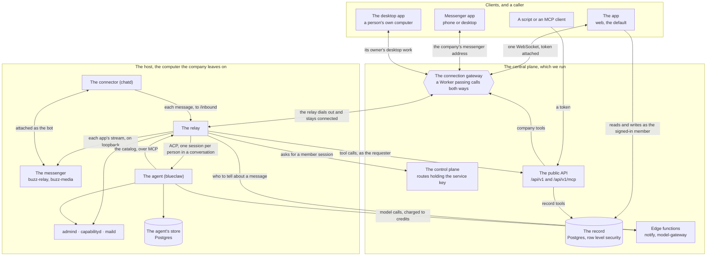
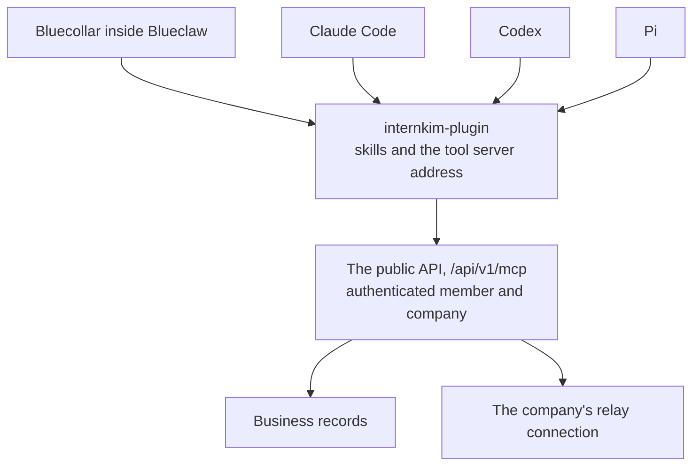

Two machines. One holds what must survive any computer, the other runs the
agent and holds what only makes sense on that machine.



Every arrow leaving the host points outward. None points in.

## How the app reads

The web app and the native app's shared web screens read the same way. A route
accepts account-scoped data only after the session and the company membership
are verified. A screen opens on the last snapshot it read for that account and
reads again behind it; a write, signing out or a refused read discards the
snapshot, and editing a record waits for fresh data. A task board reads the
range on screen, and a view that needs the complete history asks for it. The
attendance screens read the requester's own state through
`attendance_current_get` and colleagues a page at a time through
`attendance_team_page_get`. The service worker caches the shipped static files
and never an authenticated page or an API answer. How these reads are timed is
in [Testing](/testing#measuring-speed).

## One plugin across harnesses

blueclaw is a meta-harness. It runs an agent harness for everyone in the
company and supplies what a harness cannot have alone: the person behind each
message and their POSIX user, approval in that person's thread, the task
ledger and schedules. The company host runs bluecollar, the default harness.
blueclaw can run Claude Code, Codex, Antigravity or any ACP agent in its place,
and each is briefed with the same facts, asks its approvals the same way, runs
as the requester and resumes its own session after an approval or a restart.

`internkim-plugin` is the shared client package. The agent loads the skills
from it, and Claude Code, Codex and Pi can install the same package to use the
company's tools from a person's own loop.



The plugin is a plain Agent Plugins checkout: `plugin.json`, `mcp.json` naming
`https://api.intern.kim/v1/mcp`, and `skills/`. There is no harness adapter, and
each client loads that layout its own way; the plugin's README has the recipes.

The service authors each tool contract once, derives the actor from the
caller's authentication and checks current company membership, so a model's
arguments cannot select a more privileged identity. MCP carries tool calls. ACP
is the separate boundary by which the relay hands messenger conversations to the
agent, and using the plugin alone needs no ACP session. Installing the plugin
does not expose blueclaw's workspace or terminal to an external agent.

Under bluecollar the model's kernel is `read`, `write`, `edit`, `bash`, `plan` and
`equip`, beside the file, skill, question and memory tools blueclaw's
[reference](https://blueclaw.intern.kim) lists. `plan` records the goal, its steps and the level that sizes the run.
`equip` takes a sentence describing a need and answers with the tools that serve
it, and the rest of the company catalog reaches the model as a shortlist settled
once per plan step. The model speaks through a single `reply` that carries the
words and any files, and that can park the run until somebody answers or offer
choices as buttons.

## The central side

Five things, deployed by us.

| | What it is | Where it lives |
|---|---|---|
| the record | Postgres behind row level security | `supabase/migrations` |
| the control plane | server routes holding the service key | `web/src/routes/api/agent/` |
| the app | a SvelteKit build on Cloudflare Pages, serving the pages people sign into | `web/` |
| the public API | server routes in the same build, answering tokens and MCP clients | `web/src/routes/api/v1/` |
| the connection gateway | a Worker with one Durable Object per company, carrying browser calls, API calls, the native messenger apps, the company's work queue and desktop work for a person's own computer | `workers/connection-gateway/` |

The record answers every read and write as some member, never as an
administrator. Which rows a session sees is decided by the database itself.
The tables are listed in [What lives where](/what-lives-where).

The control plane exists for what a member cannot do alone. Its callers
authenticate with a company's agent key, and what it hands back is a session:
`POST /api/agent/session` turns an identity the company knows into a member
session, `POST /api/agent/host-session` signs the company's computer in as
itself. Sibling routes under the same directory let that signed-in host read
the credentials it needs per call (`/api/agent/messenger-credential`,
`/api/agent/mail-account`). The service key never leaves these routes.
Notifications are sent by the project's own edge functions
(`supabase/functions/`), so the key that reads every member's devices stays
inside the company's Supabase. The `model-gateway` function beside them sells
model calls against the company's credits, as [Credits](/record/schema#credits)
describes.

The app decides at runtime which Supabase project it talks to:
`hooks.server.ts` injects the values into the `#central-plane` element, so one
build serves every company. The pages hold no secret; the API routes under
`/api/` do, which is why they run on the server. Everyone signs in at one
address; every other hostname on the zone answers `308` to it, except paths
under `/api/` and `/v1/`, which are answered where they land because a
cross-origin redirect would drop the caller's bearer token. That exception is
what lets `api.<zone>/v1` answer as the same API as `<zone>/api/v1`.

The public API is where the tool catalog lives. Every tool is defined once,
in `web/src/lib/server/public-api/catalog/`, and each definition names who
answers it:

| `answeredBy` | Who runs it | Examples |
|---|---|---|
| `record` | the app itself, against the record, as the calling member | tasks, the calendar, people, leave, attendance, CRM |
| `company` | the company's computer, reached through the gateway | messages, mail, web search, reading a document |
| `local` | only beside the agent; the API refuses it | the browser, the requester's own computer |

`/api/v1/mcp` serves the same catalog to any MCP client, and it is also how the
agent itself reaches its tools, as the sections below show. The
[catalog](/tools/catalog) lists every tool.

The connection gateway is how a browser and the host reach each other when
neither accepts a connection. The browser opens a WebSocket to
`/company/<id>/client` carrying its Supabase session token; the Worker
verifies the token against the project's JWKS, resolves which member is
calling, and hands the socket to that company's Durable Object
(`CompanyConnectionObject`). The host's relay dials `/company/<id>/server`
from its side and stays connected, authenticated by a server key the Durable
Object stores. The object forwards calls one way and answers the other, pushes
`message.arrived` to open chat screens when the relay reports a new message,
and tells browsers whether the company's computer has a live connection.

The same object keeps the company's work queue. Each box dials
`/company/<id>/worker` and says how much room it has. The service box runs a
browser call itself while one of its browsers is free and otherwise posts it
to `/company/<id>/work`, where whichever connected box has room takes it
([More than one box](/kim-mini#more-than-one-box)).

The internkim desktop app dials `/company/<id>/desktop` with the signed-in
member's session token once its person lets internkim use that computer. The
Worker resolves the member as it does for `/client` and keys the socket on
their email address. Work for a person's desktop leaves the host through the
relay: capabilityd posts it to the relay's `/desktop-work`, and the relay
forwards it to `/company/<id>/desktop-work` signed as the host that serves the
company. The work names that address, and the Durable Object hands it to that
person's socket alone, or answers `503` when they have none open. It never goes
to another person's desktop or to a box, and company work never goes to a
desktop. The gateway holds desktop work for 120 seconds, and both desktop tools
declare that limit. [Your own computer](/tools#desktop) says what the
desktop tools do there.

A native messenger app on a phone or a desktop dials the company's messenger
address, `<slug>.<zone>`, which is a route on the same Worker and not a Pages
hostname. The Worker finds the company by the first label and opens a stream
on the host's standing connection: `stream.open`, then `stream.frame` and
`stream.close`, each carrying a stream ID. For each stream the relay dials the
company's Buzz relay on loopback and presents the address the app dialled, so
the app's NIP-42 login reaches the relay that checks it, and the gateway never
reads a frame. A frame over 512 KiB, the Buzz relay's own limit, is refused
before it enters a stream. When the host's connection drops, every stream
closes with `1012` and the apps dial again. The relay sends streams out in
turn, one frame each, so one busy subscription cannot hold the connection.

The rest of what an app sends is HTTP. NIP-98 queries, invitations and the
relay's information document travel as calls on the same connection.

The relay decides who may read a blob, and the company's copy of it in the
bucket supplies the bytes. The gateway first calls `messenger.media.head` with
the app's headers as they arrived, token and range included, and the host asks
its relay for a HEAD with exactly those. A refusal goes back to the app as the
relay gave it, with no body. When the relay allows the read and the bucket
holds the copy at `<company>/shared/transfer/<digest>`, the host answers with
an address for it, signed for a minute. The gateway reads the copy with the
app's range and answers with the relay's headers and the copy's length and
range, so the bytes cross neither the Durable Object nor the host's connection.

When there is no copy yet, the gateway sends `media.open` and the host streams
its relay's answer: the status and headers, the body in binary frames of at
most 512 KiB, and `media.end`. It sends only bytes the gateway has granted, and
the gateway grants them as the app reads, so the Durable Object holds at most
512 KiB of any one blob and at most 32 blobs at once. Meanwhile the host fills
the copy, once per digest however many apps ask. It reads the whole blob
through the connector as the requester, with the key the company holds for
them, which is how a browser's read is made too. A fill that fails logs one
line naming the digest and the reason.

An upload is staged in the bucket and the host hands it to its relay from
there. When the relay accepts it and names the digest the staged bytes hash
to, the staged object is moved to that digest's copy, so a file sent from an
app is read from the copy from the start. A redirect would be simpler than
staging, but the desktop app refuses one when it saves or copies a file.

A host names what it can do in its handshake. One that does not name
`messenger.media.head` is never asked for a head and streams every read. One
that does not name `messenger.media.stream` either is asked the oldest way,
which copies the blob into the bucket before answering. A host sends a body as
base64 in JSON to a gateway whose `media.open` does not ask for binary frames.

The Durable Object accepts every socket through the WebSocket Hibernation API.
Each socket's role sits in its attachment, the runtime answers the host's
keep-alive ping without waking the object, and a member's call still waiting
for its answer is kept in the object's storage, so the object can sleep between
messages and lose nothing.

## The processes on the host

The package registers each as its own service with systemd or launchd;
[Running the host](/running-the-host) shows how to check them.

| Process | Answers on | Job | Code |
|---|---|---|---|
| the relay (`internkim-relay`) | outbound only; `127.0.0.1:18091` for the connector | answers the app's calls, turns messages into agent turns, serves the agent its tools | `host/relay/` |
| the connector (`chatd`) | `127.0.0.1:18090` | the messenger adapter for Buzz | `.dependency/blueclaw/chatd/` |
| the agent (`blueclaw`) | `/run/internkim/acp/blueclaw-acp.sock`; admin API on `127.0.0.1:8080` | the meta-harness and its ACP agent: runs, approval, the task ledger, memory | `.dependency/blueclaw/` |
| `internkim-capabilityd` | `/run/internkim/capability.sock` | answers the agent's tool calls and holds their provider credentials: the mail, web, browser and desktop tools; passes embedding requests on to the embedding server | `cmd/internkim-capabilityd/`, `internal/capabilityd/` |
| Moli (`moli serve`), one per requester | `127.0.0.1:9230` and up | the device browser for plain public-text navigation; capabilityd starts each person's on first use, with their own profile, and stops it when idle | `internal/browser/device_browsers.go` |
| `internkim-admind` | `127.0.0.1:18080`, `/run/internkim/admind.sock` | the workspace screens, the roster, and the company tools the plane carries to the host | `cmd/internkim-admind/`, `internal/admind/` |
| `internkim-maild` | `127.0.0.1:18092` | answers mail for whichever account a call carries | `cmd/internkim-maild/` |
| `internkim-embedding` | `127.0.0.1:18095` | llama.cpp serving EmbeddingGemma 2 on the CPU; every memory and skill is embedded here, with weights the package carries | `internal/runtime/blueclaw/company_host_services.go` |
| the box (`internkim-box`) | outbound only | claims the computer for a company, keeps its identity and the company key, stands by or takes over | `internal/box/` |
| the agent's store | `DATABASE_URL` | Postgres holding conversations, runs, policy | `.dependency/blueclaw/migrations/` |

The package also runs the host's database and cache, the messenger
(`buzz-relay`, `buzz-media`), the daily backup and, on a company of several
boxes, the WAL and file followers. [Check services](/running-the-host#check-services)
lists them.

capabilityd ends each tool call at the limit its tool declares in
`timeoutSecond`, 300 seconds when it declares none, and answers a call that
ran out with `timeout`, saying the work it started may still have taken
effect. A handler that crashes is answered with `tool_crashed`, and
capabilityd keeps serving.

## What the agent is made of

blueclaw is one process built from separate repositories, each with one job:

| | Job | Where |
|---|---|---|
| [blueclaw](https://github.com/yeomyeonggeori/blueclaw) | the meta-harness: identity, the approval gate, the task ledger, the ACP agent the relay talks to | `.dependency/blueclaw/` |
| [bluecollar](https://github.com/yeomyeonggeori/bluecollar) | the default harness: the agent loop and the model client | `.dependency/blueclaw/.dependency/bluecollar/` |
| [blueprotocol](https://github.com/yeomyeonggeori/blueprotocol) | the contract packages blueclaw and bluecollar share: tool descriptors, task event names, approval targets | `.dependency/blueclaw/.dependency/blueprotocol/` |
| [bluememo](https://github.com/yeomyeonggeori/bluememo) | long-term memory: facts extracted from finished work, scoped by owner and circle | `.dependency/blueclaw/.dependency/bluememo/` |
| internkim-plugin | the skills the agent loads for a kind of work | `.dependency/internkim-plugin/` |

Memory is one SQLite file per subject, in that subject's protected directory
in the workspace, as [What lives where](/what-lives-where#a-persons-memory)
lays out. When a run finishes, bluememo has a model extract
self-contained sentences from it; a newer sentence replaces an older one, and a
person can ask the agent to forget one. Recall searches the file by embedding
and by words and answers without calling a model. The embedding is made on the
host, by the embedding server, so no text a person remembered leaves the
computer to be embedded. None of it lives in Postgres.

Models are named in one place, `internal/modelladder`. capabilityd prints the
ladder the agent's runtime reads: for each tier, the endpoints to try and the
file holding each one's key, staged for the agent's service account alone.
Each tier tries the `model-gateway` edge function first, which charges the call
to the company's credits and to the member who asked. A call it refuses falls
through to the company's own OpenRouter key when the host holds one, and a
company that runs its own model endpoint never reaches the gateway.

## How the chat screen gets answered

The app reads and writes the record directly as whoever signed in, so
attendance, leave, the calendar, work and the org chart never touch the host.
The screens that show what only the host knows go through the gateway: the
messenger, mail, the agent's runs and the approvals they wait on, its memory,
its files, and the skills it loaded.

1. The browser sends `{ kind: "call", capability, body }` down its gateway
   socket. The token was verified when the socket opened; nothing in the body
   is trusted to say who is asking.
2. The Durable Object forwards the call to the relay's standing connection,
   stamped with the calling member's ID.
3. The relay serves it and answers on the same socket, and the object routes
   the answer back to the browser that asked.

What "serves it" means depends on the capability, and each branch is in
`host/relay/forward.ts`:

- Messenger operations are forwarded to the connector at
  `/v1/platform/<platform>/<capability>`. First the relay fetches that
  member's own messenger credential from the control plane and attaches it as
  the `actor`, so the messenger sees the member's own account doing the thing.
  A member who has connected no account gets a `409`, and
  `person.credential.issue` is the call that connects one.
- Mail (`person.mail.*`) goes to `internkim-maild` with the member's mail
  account fetched per call, so no mail password is at rest on the box. The web
  app seals each password to the company key with HPKE (RFC 9180) when
  it is saved, bound to the company, the member, the field and the server it
  signs in to, and maild opens it with the copy of that key every box of the
  company keeps in `/var/lib/internkim/box`.
  Changing that server, port, security or login asks for the password again. A company with no box key keeps the readable form,
  and every such save is logged as `mail_account.kept_unsealed`.
- Workspace views (`person.memory.*`, `person.files.*`, `person.runs.*`,
  `person.skills.*`, `person.persona.*` and their siblings) and the public
  API's company tools (`person.api.request`, `person.api.file`) are forwarded
  to `admind` over its unix socket. Moving a file is described below.
- Link previews (`asset.link`) are built by the relay, which stores the
  preview image in Supabase Storage so the answer stays small.

No account in the running system stands for somebody else. Every member's work
on the messenger is done with a credential that member registered, and nothing
keeps an administrator session to act on anyone's behalf: the relay, the
connector and the company's connection record hold no messenger account of
their own. A member registers theirs from the app, through the same gateway
socket that names them on every other call. What a person hands over is the
messenger's to say. `person.credential.requirement` answers whether it wants a
sign-in, a secret or a redirect and which fields to draw, and
`person.credential.issue` turns the answers into a durable credential, proving
it works before anything is stored.

An answer larger than the byte ceiling is refused with a `413` naming the
size, because the transport would otherwise drop it silently; the ceiling and
its default are in [Running the host](/running-the-host#how-big-an-answer-may-be).

### How a file crosses

A file never travels on the socket. The call only names it, and the bytes go
through the company's `asset` bucket, whose prefixes are listed in
[What lives where](/what-lives-where#the-record).

To read one, the browser calls `person.media.prepare` for a messenger
attachment or `person.files.download` for a workspace file, with a
`transferID` it chose. The relay checks the request as the member: the
messenger reads with the member's own key, and admind lists the directory as
the member before anything is read. The relay then copies the file into the
bucket with a resumable upload, asking the connector or admind for one 6 MiB
range at a time. A copy that already exists is answered at once with its
address. Otherwise the call answers `pending`, and the relay delivers
`transfer.progress` events while it copies, then `transfer.done` with the
address or `transfer.failed` with the reason. The browser signs the address
with its own session, so row level security decides who may open it. A
messenger attachment is copied to the same digest-named object a native app's
read fills, with the digest taken from its address, and both kinds of read
share one fill, so a file read once by either is ready for the other.

To send one, the browser uploads it into its member's `upload/` prefix with a
resumable upload of its own, then calls `person.media.upload` or
`person.files.upload` naming the object. The relay reads it with the member's
session. For a message, the connector fetches it from a short-lived signed
address, spools it to disk while hashing it and puts it in the messenger's
media store, and the message is then sent naming what came back. For the Files
screen, the relay streams it to admind, which has Blueclaw write it as the
member's POSIX identity. Either way the upload is deleted once it is taken.

The agent sends a file the same way. Its reply names the file by its workspace
path, and the relay reads it through admind as the person the reply answers,
so only what that person may read is posted. The relay copies it into that
member's `transfer/` prefix, calls `person.media.upload` with the member's key,
and posts a message as the agent naming what came back. The reply counts as
delivered only when both the upload and the post landed. A reply's files go out
before its words, so when a file does not arrive the person gets a notice
naming it instead of words saying it is attached.

No process holds a whole file. Bun reads an HTTP response as fast as it
arrives, whatever the reader does with it, so every read is one bounded range.

## How a message becomes work

The connector attaches to the messenger as the company's bot member, through
the adapter matching `MESSENGER_PLATFORM`
(`.dependency/blueclaw/chatd/src/adapters/`), and normalizes each arriving
message. From there the relay carries it:

1. chatd posts the event to the relay's `/inbound` on `127.0.0.1:18091`. The
   relay writes it under `RELAY_STATE_DIR` and answers `202` only once it is on
   disk; chatd retries until it gets that answer, so a message survives either
   process restarting.
2. The relay opens one ACP session for each person who speaks in a
   conversation, on `/run/internkim/acp/blueclaw-acp.sock`, and sends the
   message as a prompt in the sender's own session. The session names who is
   asking and where to reply, and it names the relay's own `/mcp/<ticket>` as
   the agent's tool server, so a second person in a channel never runs as the
   first.
3. blueclaw runs the turn. Every tool call it makes to that address, the relay
   forwards to the app's `/api/v1/mcp` as the requester, with a member session
   it minted for them, so the agent never holds the bearer.
4. Each reply comes back over ACP as the agent writes it, naming the thread it
   belongs in. The relay posts it there through the connector and tells
   blueclaw which message it became, or why it was not posted. blueclaw
   records a reply as sent only on that word.

Approval travels the same way. When the gate holds a call, blueclaw asks
the relay over ACP, the relay posts the question into the thread it names and
reports the post as it does a reply. The question is worded in the voice the
agent uses with that requester. The relay hands the requester's next message
in that thread to blueclaw, which decides what those words mean; anything it
cannot read as a yes declines, and the message goes on to the agent as the
next instruction. blueclaw holds the open question and asks it again after a
restart without posting it twice, and the relay keeps which session answers
which conversation in `sessions.json` beside the inbound queue.

The agent behaves identically whichever client the person typed in.

Separately, the messenger server reports every message it accepts to the
relay on the same loopback port. The relay resolves who was addressed and asks
the `notify` edge function to reach them, which arrives as a web push wherever
those members registered a device. It also tells the gateway, so open chat
screens fetch the new message.

## How someone in the messenger becomes someone in the record

A person who has never opened the app still has a row in the record. Whatever
acts for them on the host proves the company with its key, names the identity
that spoke, and receives a session for that member.

```
POST /api/agent/session
Authorization: Bearer <the company's agent key>

{ "kind": "email", "externalID": "…" }
```

The relay asks when it opens a tool server for a requester, and again five
minutes before that session expires. The control plane refuses an identity
nobody claims, and refuses a member whose company is not the one that key
belongs to. What comes back is an ordinary member session, so everything the
agent does in the record is bounded by that person's own permissions.

## Where the messenger runs [#where-the-messenger-server-runs]

On the host. The package runs the Buzz stack there as `buzz-relay` and
`buzz-media`, both on loopback, and the connector reaches it the same way. A
native app reaches it from any network through the gateway, and the chat screen
through the relay, so the conversation is never written centrally: the relay
sends back only the answer to the call it was asked.

## Why the host has no inbound port

Exposing a company's computer means a tunnel, a certificate, a hostname, and
a new way in. Instead the browser, the messenger apps and the host all connect
outward to the gateway, which passes calls and streams between them. Your firewall stays as it was.

Once it belongs to a company, the host proves this about itself with one
command:

```bash
ss -ltnp | grep -v '127.0.0.1\|::1'    # prints nothing
```

Administering the machine is a separate question with a separate answer. On
the same network, `ssh` reaches it and nothing else is needed. From
elsewhere, put whatever you already use in your own `~/.ssh/config`:

```
Host my-company-host
  ProxyCommand cloudflared access ssh --hostname %h
```

A Cloudflare Tunnel is one convenient answer, and the one we use for our own
company's host. Tailscale, a jump host and WireGuard are others. internkim
installs none of them, asks for none of them, and cannot tell which you
chose: the choice is yours and it stays outside the product.
