Everything internkim does happens through a tool call. You ask in plain
language in the messenger; the agent decides which tools answer it and calls
them under your identity. There is no command syntax to learn.

## Asking in practice [#asking]

| You write | What runs | What you get back |
|---|---|---|
| "give Example Park a task to draft the quarterly report, due Friday" | `task_add` | the created task, with owner and due date |
| "what am I supposed to do this week?" | `task_list` | your open items this week |
| "how many days of leave have I got left?" | `leave_balance` | your remaining days for this year |
| "move Thursday's design review to four" | `event_list`, then `event_update` | the moved event |
| "DM Sample Lee that the deck is finished" | `message_send` | a draft, sent after you approve it |
| "in last week's announcement, fix the date and nothing else" | `message_search`, then `message_update` | the corrected span in your earlier message |
| "find out what changed in the new tax bill" | `web_search` | ranked public-web results, summarized |

Mutating tools take *hints* (`taskHint`, `eventHint`, `personHint`): the
title, name, or ID you actually know, resolved server-side to one canonical
record. A fragment is enough — "Park" reaches Example Park without the agent
looking anybody up first. An ambiguous hint never guesses: the call fails with
a candidate list to choose from, and choosing is what `person_list` is for.

## Two families [#families]

Capability tools touch shared records and the world outside: tasks, the
calendar, messages, channels, the public web, the browser.
The catalog holds <ToolCount /> of them under protocol
<ToolProtocolVersion />. Each descriptor's `answeredBy` names who answers it.
`record` tools, such as tasks, the calendar, people, leave, attendance and the
CRM, run on the central plane against the record. `local` tools, the browser
and the desktop, run only beside the agent. `company` tools, such as messages,
mail, the web and schedules, are carried to the company's computer. On the host the agent calls them over
MCP through the relay, the same catalog the [HTTP API](/api/tools)
serves.
The [catalog](/tools/catalog) lists every one.

Workspace tools touch your files and the terminal: read, write, edit,
run a command, deliver a finished file. They are built into the agent host
(blueclaw) and execute as your own Linux user, so POSIX permissions bound
what they can reach ([Boundaries](/boundaries#files-and-execution)).
See [Files and the terminal](/tools/workspace).

## What a side-effect class means [#side-effects]

Every tool descriptor carries a `sideEffectClass`. It states what kind of
mark running the tool leaves, and the approval gate reads it. The tool's name
never decides.

| Class | The mark it leaves | Examples |
|---|---|---|
| `read` | none | `task_list`, `message_search`, `leave_balance` |
| `computation` | none; an answer is worked out and nothing is kept | `company_document_classify` |
| `workspace_write` | a company record created or changed | `task_add`, `event_update`, `write` |
| `external_write` | state on the messenger changed | `message_update` |
| `external_send` | a message reaches people | `message_send` |
| `connect` | a session to something opens | `browser_open` |
| `destructive` | something irreversible | `task_delete`, `message_delete` |

## When the agent stops and asks [#approval]

Whether a call pauses for your approval is descriptor metadata
(`requiresApproval`), checked by the approval gate in
`.dependency/blueclaw/internal/approvalgate` before the call executes. The
[catalog](/tools/catalog) marks every tool the flag is set on, so read it
there rather than from a list written by hand. Among workspace tools,
`file_delete` is gated, and `bash` gates itself per call: the agent sets
`approvalRequired`, with an `approvalReason` in the requester's language, on a
command it judges consequential.

One exemption: a `message_send` that lands in the conversation the agent is
answering does not need a second yes. That is `currentThread` and
`currentChannel`, a `channel` named by the current channel's ID, and a
`directMessage` with no recipient asked from the requester's own direct
conversation. A direct message to anyone else, or to the requester from a
channel, still asks.

Scheduled work is asked about once, when it is scheduled. `schedule_create`
and `schedule_update` are gated, and the question reads the instruction and
how often it runs back to you. Each run of a schedule you approved then
carries out whatever its instruction needs without asking again, whether it
runs once or every week. A run acts as you, so it can do nothing you could not
do yourself.

Browser calls ask by what the page would send in your name. While the agent's
browser runs, a request with a method other than GET, HEAD, OPTIONS or TRACE
(the safe methods of RFC 9110) is stopped before it leaves when the browser
holds cookies for its address. The browser's own cookie jar decides, so a search
form on a site that never set a cookie goes out unasked. A request stopped
during a browser call makes that call ask. One a page sends later by itself,
such as a delayed send, is put to you on the next browser call, which waits for
your answer before it runs. The question shows each request's method, address
and form fields. Approving sends exactly those, once, from the same browser with
its cookies. Declining sends nothing. Beacons (`navigator.sendBeacon`) that
would carry cookies are dropped without a question, and a browser that cannot
stop requests does not act at all. GET requests are not asked about.

The approved request is kept in the hold, so it survives a restart. A body over
64 KiB is the exception: it stays only in the browser service's memory, and if
that service restarted before you approved, nothing is sent and the agent asks
again.

A sign-in, a one-time code or a check meant for a person is never the agent's
to do. It calls `browser_handoff`, which posts a link in the thread. The link
opens the agent's browser live in the app for the person who asked, and for
nobody else. You work in it and press Done or Stop. The task waits on that as
it waits on an approval, and resumes when you hand the browser back or after
fifteen minutes. The agent is told how it ended, which site the browser shows,
and whether that site's cookies changed. While you hold the browser its
requests are yours and go out unasked, and the agent's own browser calls are
refused. The screen and your typing travel between the company's computer and
the app through the connection gateway, which keeps neither.

<Callout>
A held call is persisted to the task ledger as `approval.hold_opened`, so an
approval survives a daemon restart. Approving replays the recorded call
verbatim; declining tells the model to stop, and it is instructed never to
retry a declined call.
</Callout>

## Tools that come and go [#availability]

Each descriptor carries an availability state (`ok`, `not_connected`,
`not_ready`, `not_allowed`). Browser tools run in a browser on the company's
computer, one per requester with its own profile. Tools from configured
[MCP](https://modelcontextprotocol.io) servers join the same registry and
meet the same gate. `GET /api/v1/tools` answers the base set your token
reaches; `?live=true` asks the company's computer what it can run right now.

## How long a call may run [#budgets]

A descriptor may declare `timeoutSecond`, the seconds one call of that tool may
run. The company's computer serves every descriptor that declares none with
300, so each tool's budget is decided in one place
(`internal/capabilityd/tool_invocation.go`). The agent waits five seconds past
the budget, so the company's computer is the one that answers when a call runs
out. That answer fails with `errorCode` `timeout` and tells the model the tool
did not finish within that many seconds and that the work it started may still
have taken effect. A tool that crashes while it runs fails with `tool_crashed`,
and the service keeps answering other calls.

## Your own computer [#desktop]

`desktop_read` and `desktop_act` operate apps on the computer of the person who
asked, through the internkim desktop app open there. They run
[agent-desktop](https://agent-browser.dev/desktop) on that computer, so each
person's own hardware does the work and the company's computer runs no desktop
for anyone.

Desktop work is addressed by the requester's sign-in. The company's computer
posts it to its relay's `/desktop-work` under the requester's email address,
the relay hands it to the connection gateway's `/company/<id>/desktop-work`,
and the gateway gives it only to a desktop app signed in as that person. No
call can send it to a colleague's computer or to a box that serves the company.
When the requester has no desktop app taking work, the call fails with
`desktop_unreachable`. When the company's computer cannot send the work on,
because its relay did not answer, has no gateway, or got no answer from the
gateway, the call fails with `desktop_unavailable_on_this_host` and says which.

Two consents stand in front of it. Right after the first sign-in, the desktop
app asks once, in a native dialog, whether internkim may use this computer.
Nothing turns on without its Allow, and Cancel is an answer it does not ask
again. On a Mac that has not granted the app the accessibility permission,
allowing opens System Settings at that pane. While it is on, a tray item shows
it and turns it off, as does the switch in settings. Both tools declare
`requiresUserPresence`, so scheduled runs never get them: no one is there to
watch.

A web page on that computer is the work of
[agent-browser](https://agent-browser.dev), which the same two tools run when
`program` names it. It opens a browser window of its own, signed in to nothing,
beside whatever browser the person already has open.

`desktop_read` runs only commands that change nothing, and `desktop_act` runs
those and the ones that do: clicks, typing, key presses, launching and moving
apps, the clipboard. For each program the two lists, the options never passed, and the
pinned release with its hash are kept in
[`internal/desktop/commands.json`](https://github.com/yeomyeonggeori/internkim/blob/main/internal/desktop/commands.json),
which the company's computer and the desktop app both read, and both refuse
before running. A command on neither list, such as agent-browser's `eval`,
`connect` or `flow`, is never run. The refused options include the ones that
open or join a debugging port (`--cdp`, `--auto-connect`), reach a browser
profile or saved logins (`--profile`, `--state`), or run script
(`--restore-check-fn`). The text a `type` or `fill` writes travels in its own
`text` field, and the agent is told never to type a password or a one-time
code.

A `snapshot` that chooses no size is asked for in its interactive, compact
form. One longer than 16,000 characters is asked for again at depth 3, then 2,
then 1, and the first that fits comes back with a note saying how long the one
asked for was and which commands read one region of it in full.

After an act the program reports as delivered, the company's computer asks for
a snapshot of the window or page that act left and returns it with the act's
own answer, so the next ref is already there. When that snapshot cannot be
read, the act's answer still comes back and says why the screen is missing.
Both tools declare a 120-second budget, the time the gateway holds desktop
work, and reading the screen stops ten seconds before it runs out.

## How tools are named [#naming]

A tool's name is the only part of it a model sees before deciding to call it,
so the tools internkim owns follow one shape, and `tools/verify-tool-naming`
fails a change that breaks it:

```
<namespace>_<subject>_<verb>        crm_opportunity_move
<namespace>_<verb>                  task_add
```

The namespace matches the descriptor's `namespace`. The subject is dropped when
the namespace already names it, which is why `event_add` and `crm_contact_add`
are both right. The verb comes last.

| Verb | Means | Instead of |
|---|---|---|
| `add` | bring a new record into being | create, register, save |
| `list` | several records, filtered | index, fetch |
| `get` | one record, or one settings block | read, show |
| `update` | change the named fields of a record | edit, modify, patch |
| `delete` | remove a record | remove, destroy |
| `search` | several records, ranked by a query | find, lookup |

Another verb is allowed only when the act is none of these and the domain has
its own word for it: `crm_opportunity_move` moves a deal between stages, and
`person_invite` sends an invitation. `set` is kept for a settings block written
whole, where `update` would suggest that unnamed fields survive.

Every word in a name appears in the tool's own description, so the word a model
learns from the description reaches the tool. Parameters are camelCase and
spelled out, and a few carry a fixed meaning everywhere: `<thing>Hint` is a
natural reference resolved server-side, `limit` caps the answer, `query` is
what a `search` ranks against, `scope` says whose records a call reads,
`startsAt` and `endsAt` are RFC 3339 instants, `date` is a `YYYY-MM-DD` day in
the company's zone, and `reason` is why a record was written by hand.

A tool that reads many records a page at a time takes `limit`, at most 100, and
`cursor`, copied from the previous answer's `nextCursor`, and answers
`totalCount`. `nextCursor` is present only while records remain. A page nothing
can count without reading everything, as in `message_search` and the mail
lists, answers without `totalCount`.
`tools/verify-list-tool-pages` fails a tool that caps its answer without saying
what it left out.

The agent's kernel tools, such as `bash`, `read`, `write`, `edit`, `plan` and
`equip`, are exempt. They carry the names other coding agents use, so a model recognizes
them on its first turn. Tools from outside MCP servers keep their own names.

## Where this is implemented [#implementation]

```mermaid
flowchart LR
  TS["web/src/lib/server/public-api/catalog/<br/>(source of truth)"] -->|make generate-protocol| JSON["pkg/capabilityprotocol/generated/<br/>capability-tools.json"]
  JSON -->|embedded, hash-checked| Go["pkg/capabilityprotocol"]
  Go -->|admind stamps runtime.json| Blueclaw["blueclaw<br/>capability_tool_provider"]
  Blueclaw -->|approvalgate| Socket["/run/internkim/capability.sock"]
  Socket --> Capabilityd["internkim-capabilityd<br/>executes the operation"]
```



| Layer | Where | What it owns |
|---|---|---|
| descriptor source | `web/src/lib/server/public-api/catalog/` | every field of every capability tool |
| descriptor shape | `.dependency/blueclaw/protocol/src/capability.ts` | what a descriptor may say, and nothing about which tools exist |
| generated catalog | `pkg/capabilityprotocol/generated/capability-tools.json` | the embedded, hash-validated copy Go code reads |
| descriptor grouping | `internal/capabilities/protocol.go` | which descriptors each provider registers |
| config rendering | `tools/render-company-runtime` | reads `capabilities.toolDescriptors` out of the installed `capabilityd` into blueclaw's `runtime.json` |
| agent binding | `.dependency/blueclaw/internal/agentruntime/capability_tool_provider.go` | validates descriptors, binds them into the model's tool set |
| approval gate | `.dependency/blueclaw/internal/approvalgate/turn_gate.go` | holds gated calls for a human |
| execution | `internal/capabilityd/*_tool.go` | the operation behind each namespace |

Changing a tool means editing the TypeScript descriptor, running
`make generate-protocol`, and shipping `capabilityd` and the blueclaw payload
in the same release; blueclaw refuses a descriptor set whose protocol
identity hash does not match its own, and a host picks up the new set when
its package renders the runtime document again.

<Cards>
  <Card title="Tool catalog" href="/tools/catalog" description="All capability tools, by namespace, generated from the canonical catalog" />
  <Card title="Files and the terminal" href="/tools/workspace" description="Workspace tools, the POSIX boundary, and skills" />
  <Card title="Calling tools over HTTP" href="/api/tools" description="The same tools from outside the messenger" />
</Cards>
